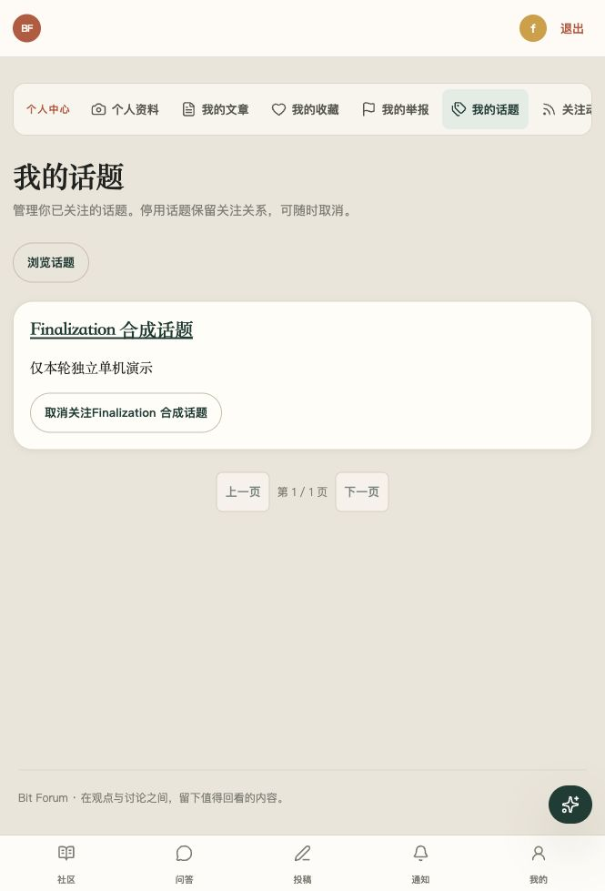
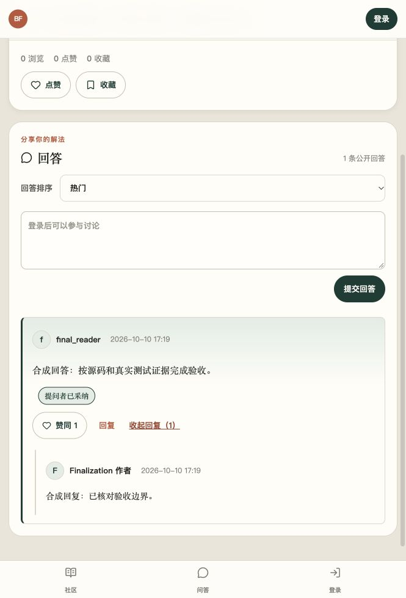
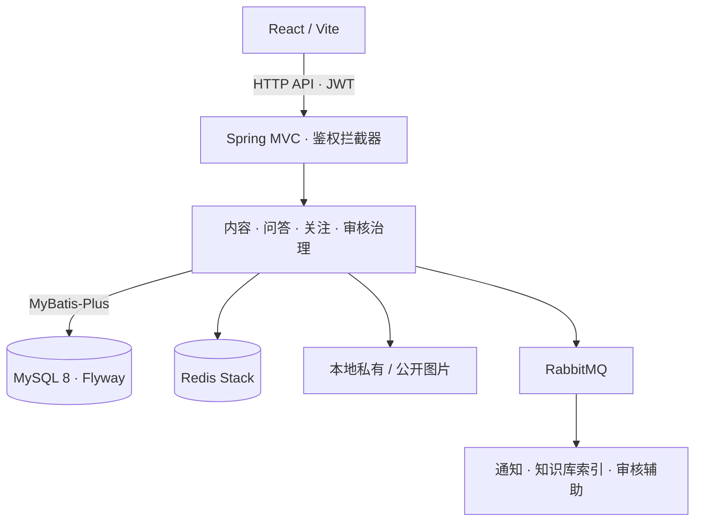

<h1 align="center">BitForum</h1>

<p align="center"><strong>内容分享 · 技术问答 · 审核治理</strong></p>

<p align="center">
  Java 17 · Spring Boot 3.4.5 · React 19<br>
  MySQL 8 · Redis Stack · RabbitMQ
</p>

<p align="center">
  <a href="https://github.com/JJJJIU9999/BitForum/actions/workflows/ci.yml"></a>
</p>

<p align="center">
  <a href="docs/running.md">运行说明</a> ·
  <a href="docs/architecture.md">系统架构</a> ·
  <a href="docs/database-er.md">数据模型</a> ·
  <a href="docs/testing.md">测试与 CI</a>
</p>

BitForum 是基于 Spring Boot 与 React 的社区系统，也是 Java 后端开发作品与计算机专业毕业设计。项目围绕内容发布、问答互动和审核治理，展示权限门禁、异步消息、关注动态、数据库迁移与隔离测试的工程实现。

## 界面预览

两图来自 **2026-10-11 人工合成数据环境的既有页面演示**，不代表当前发布版本的完整浏览器验收；拍摄背景与时间显示边界见 [图片来源说明](docs/images/README.md)。点击图片查看原图。

<table>
  <tr>
    <th align="center">我的话题</th>
    <th align="center">回答采纳与单层回复</th>
  </tr>
  <tr>
    <td align="center"><a href="docs/images/my-topics.jpg"></a></td>
    <td align="center"><a href="docs/images/answer-reply.jpg"></a></td>
  </tr>
</table>

## 功能概览

| 产品能力 | 已实现内容 |
|---|---|
| 内容发布 | 文章与问题、草稿编辑、驳回后修改、Markdown / 纯文本、预览、分类搜索与审核 |
| 问答互动 | 回答点赞、单层回复、采纳 / 更换 / 取消采纳、热门与最新排序 |
| 关注发现 | 作者关注、话题目录与搜索、话题关注、我的话题、混合关注动态 |
| 用户互动 | JWT / BCrypt 注册登录、资料与公开主页、文章点赞 / 收藏 / 评论、通知 |
| 审核治理 | 文字规则与复扫、人工待办、头像与封面审核、举报处理 |
| 管理后台 | 用户 / 内容 / 分类管理、审核记录、统计看板与健康检查 |

## 系统架构

React 前端与 Spring Boot 单体后端；下图为源码模块关系，完整组件与 AI 链路见 [系统架构](docs/architecture.md)。



MySQL 保存业务数据与审核记录；Redis 承担指标、热榜、消息处理标记及向量索引；RabbitMQ 触发异步处理。图片文件存于本地磁盘，归属与审核状态保存在数据库。

## 后端工程设计

### 关注动态：双来源去重与游标翻批

作者与话题关注共同组成动态。SQL 以 `PUBLISHED` 约束两个来源，通过 `EXISTS` 避免重复行；按时间与 ID 排序，读取 `pageSize + 1` 判断下一批。游标校验用户、内容类型及排序边界，每次查询仍执行可见性门禁。

[查询源码](src/main/java/com/bitforum/mapper/ArticleMapper.java) · [游标校验](src/main/java/com/bitforum/service/FollowFeedCursor.java)

### RabbitMQ：提交时序与重复消费保护

知识库索引和审核辅助消息在事务提交后投递，避免消费者读取未提交状态。审核通过通知消费结合 Redis 标记与数据库唯一消息 ID 防止重复落库，成功后 ACK，失败进入死信队列。提交后投递不代表数据库与 Broker 原子提交，当前没有 Outbox 或自动死信重放。

[提交后执行](src/main/java/com/bitforum/message/AfterCommitExecutor.java) · [通知消费](src/main/java/com/bitforum/service/NotificationListener.java) · [消息唯一约束](src/main/resources/db/migration/V12__add_notification_source_message.sql)

### Redis：指标数据结构与定时同步

String 记录浏览计数，Set 保存文章点赞关系，ZSet 维护热榜。定时任务将已有 Redis 指标同步到公开内容的数据库记录；指标缺失时保留数据库计数。当前采用定时全量同步，存在同步延迟。

[Redis 实现](src/main/java/com/bitforum/service/RedisService.java) · [指标同步](src/main/java/com/bitforum/service/ArticleMetricSyncService.java)

### 内容权限：角色回查与公开门禁

管理员请求回查当前账号状态和角色；文章公开前校验封面审核与文字规则。回答采纳只允许问题作者选择本问题已公开的顶层回答；图片先进入私有存储，人工批准后形成公开资源。

[管理员鉴权](src/main/java/com/bitforum/interceptor/AdminInterceptor.java) · [内容与采纳](src/main/java/com/bitforum/service/ArticleService.java) · [图片治理](src/main/java/com/bitforum/service/ImageResourceService.java)

## 可选 AI 扩展

当前实现已接通普通技术问答、多轮历史、公开文章 RAG 与引用。发送成功以服务端历史为准；超时或状态不明时保留输入、核对历史，不自动重发。DeepSeek 专属客户端固定非思考模式，关闭自动重试。

Spring AI 还包含只读工具查询、审核辅助、运营洞察和相关推荐的既有实现。本地 ONNX 生成嵌入，Redis Stack 执行向量检索；召回后再次校验文章公开状态与索引完成状态。推荐排序由后端融合结果，模型补充理由；执行轨迹、用量、软预算与统一降级用于观察和控制调用。

按 [示例配置](.env.example) 与 Compose 运行时，收费聊天、全部模型工具、模型推荐理由、模型审核、自动审核放行及运营分析模型调用均关闭。仅在本机显式启用聊天；日额度是每用户 2 元的估算软限制，预算查询失败阻断调用，不能当作账单硬封顶。真实模型效果未由 CI 验证，最新验证范围见 [发布与 CI 记录](docs/updates/20261018.md)。

[RAG 校验](src/main/java/com/bitforum/ai/rag/RagService.java) · [工具白名单](src/main/java/com/bitforum/ai/tool/ToolRegistry.java) · [推荐融合](src/main/java/com/bitforum/ai/recommend/RecommendFusionService.java)

## 工程质量

当前 V25 / AI 产品更新已完成新一轮 GitHub CI，具体提交、测试数量和边界见 [发布与 CI 记录](docs/updates/20261018.md)。下表保留 V24 的历史结果，不与本轮结果混算。

V24 发布提交 [`62d4bbb`](https://github.com/JJJJIU9999/BitForum/commit/62d4bbb97e8182823db6963ea427d1af549f9f5f) 的 [GitHub Actions 运行](https://github.com/JJJJIU9999/BitForum/actions/runs/38124122274) 中，`backend-unit`、`backend-integration`、`frontend` 三个 Job 均成功。顶部 Badge 显示 `main` 的动态 CI 状态。

| 验证项 | 已验证结果 |
|---|---|
| 后端测试 | **684 项通过**：323 无基础服务测试 + 361 服务 / 迁移 / 回归测试 |
| 前端测试 | **127 项通过**，覆盖 18 个测试文件 |
| 前端构建 | **Vite 构建成功** |
| 收费模型测试 | **13 项按策略跳过**，未计入通过数量 |
| 数据库迁移 | 历史 V24 为 **V1–V24**；当前实现新增 V25，本轮结果见发布记录 |

测试清单检查防止分类漂移；完整服务集合采用隔离实例，并在连接前校验目标。前端测试基于 Vitest / Testing Library / jsdom，上述结果不包含完整浏览器、跨设备或应用部署验收。详情见 [测试与 CI](docs/testing.md)；[独立验证记录](docs/test-results.md) 保留发布前执行范围。

## 快速开始

准备 Java 17、Node.js 22、MySQL 8、Redis Stack（含 RediSearch）和 RabbitMQ，按 [运行说明](docs/running.md) 配置独立环境。ONNX 首次加载可能下载模型文件；示例关闭全部收费模型与工具调用。Compose 模板保留 3.5 GiB 资源预算；此源码整理没有启动或升级任何已有环境。

<details>
<summary>本地验证命令</summary>

后端默认集合无需启动基础服务：

```bash
./mvnw -s maven-settings.xml test
```

前端测试与构建：

```bash
cd frontend
npm ci
npm test
npm run build
```

完整服务测试的准备条件与命令见 [隔离测试说明](docs/testing.md)。

</details>

## 文档导航

| 运行与验证 | 架构与业务 |
|---|---|
| [运行说明](docs/running.md) | [系统架构](docs/architecture.md) |
| [测试与 CI](docs/testing.md) | [数据库 E-R 图](docs/database-er.md) |
| [独立验证结果](docs/test-results.md) | [核心业务流程](docs/core-flows.md) |
| [图片来源](docs/images/README.md) | [技术边界](docs/limitations.md) |

## 技术边界与公开版本

项目面向单机学习与毕业设计演示，尚无生产性能、用户规模或线上部署验证。Redis 指标为定时同步，图片使用本地存储，JWT 保存在前端 localStorage；多数表关系由服务端维护。源码迁移版本不代表已有数据库已升级，更多开放项见 [技术边界](docs/limitations.md)。

本仓库从 BitForum V24 的独立公开快照开始；V25 / AI 产品更新通过 [PR #1](https://github.com/JJJJIU9999/BitForum/pull/1) 维护，发布状态见该 PR。后续产品开发与公开维护统一以 `JJJJIU9999/BitForum` 为目标，不导入旧开发仓库整段历史。仓库分工与后续操作见 [仓库入口](docs/repository-layout.md)。
