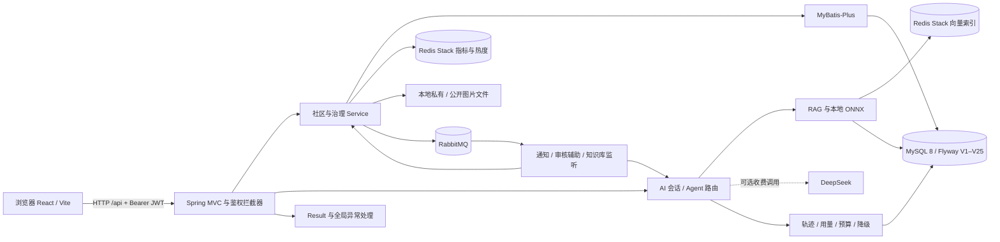

# 系统架构（源码视图）

对应当前V25候选源码的单机架构；不是实时部署拓扑。单机单体，收费 AI 为可选依赖，本轮关闭。

## 关键边界
- MySQL 保存业务事实，Redis 保存指标/热度/向量；定时指标同步不是强一致复制。
- 图片内容在磁盘，image_resource 保存审核/归属元数据；头像和封面遵循各自公开门禁。
- RabbitMQ 触发异步通知/辅助链路，不能画成事务提交与 Broker 的原子提交；尚无 Outbox。
- 推荐融合排序由后端决定，模型只生成理由；模型失败不应阻断主社区业务。
- 认证仍为 JWT + 拦截器，并非完整 Spring Security 框架。测试中新专属三服务是验证拓扑，不等于旧环境部署。

独立测试机制见 [测试说明](testing.md)，运行边界见 [运行说明](running.md)。
