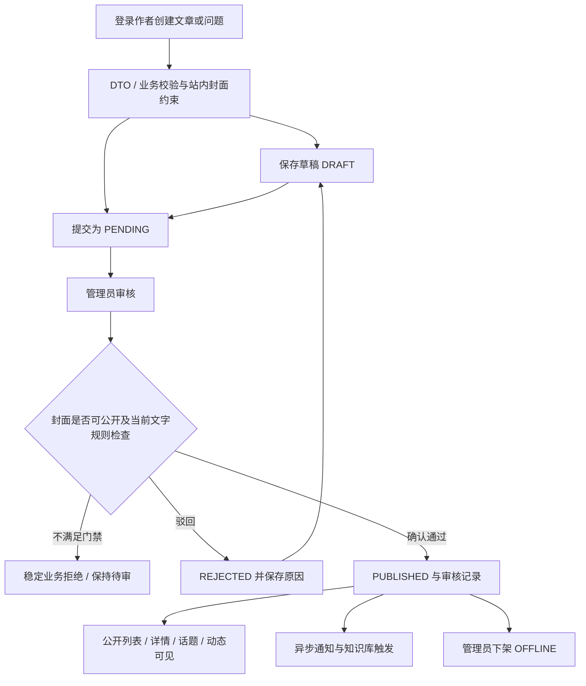
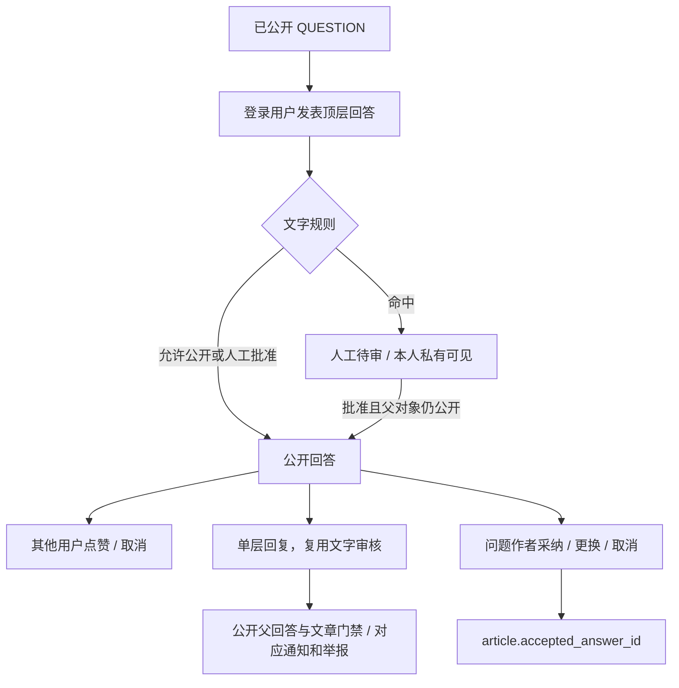
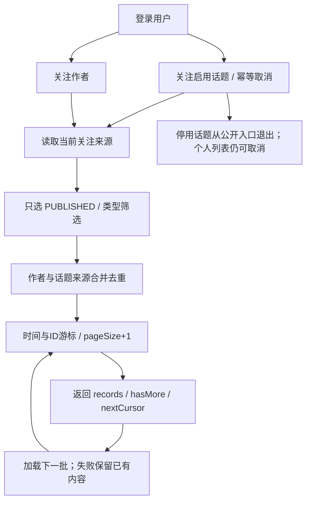
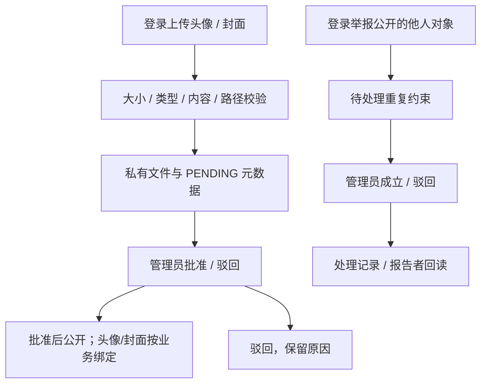

# 核心业务流程（当前实现）

本图描述源码行为；本轮执行证据和未验证事项单列，不将流程图视为测试通过。

## 内容审核与公开

管理员可人工确认文字规则命中；系统自动审核受关闭的自动放行开关和人工复核约束。MQ 发布与本地事务之间没有 Outbox，图中不声称原子提交。

## 回答、点赞、回复与采纳

禁止把回复采纳为回答；未公开内容不进入公共列表，父对象失效有专门限制。

## 话题关注与混合动态

动态不是预生成消息收件箱；排序/游标由服务端控制，前端刷新或切换类型重新读取首批。

## 图片审核与举报

文件 IO 故障属于内部错误；事务回滚清理保留。举报处理本身不自动下架文章或删除评论。
