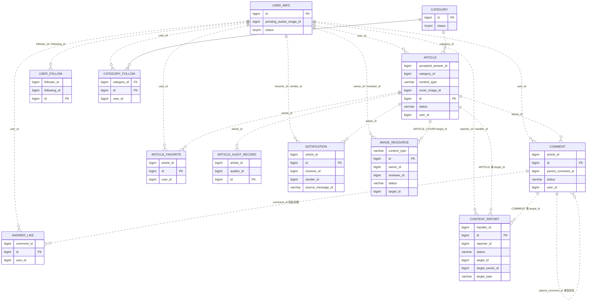
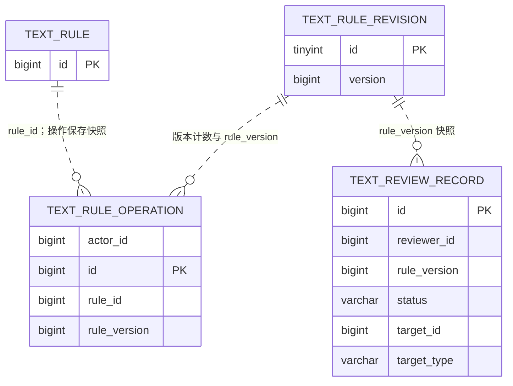
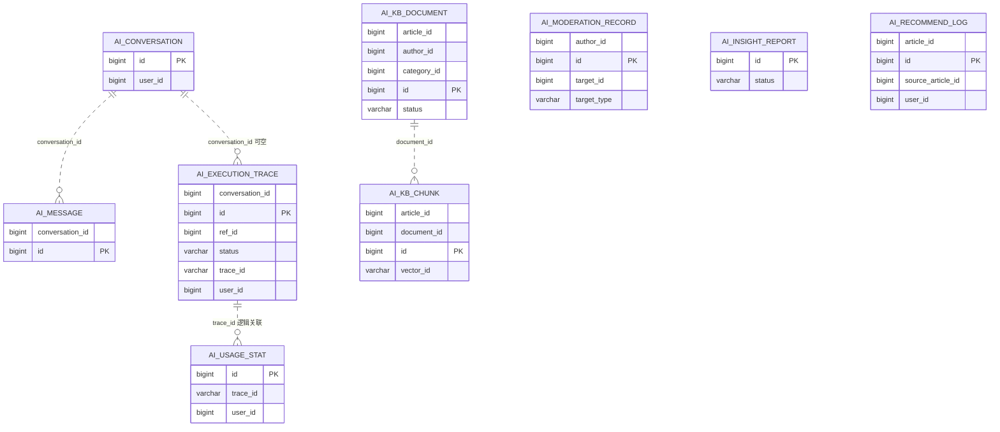

# 数据库 E-R 图（V24）

本图依据V1–V24 SQL及既有独立合成库结构回读。V24包含25业务表及1张Flyway元数据表；实际环境版本须单独回读，不由源码版本推断。完整字段可查 [迁移源码](../src/main/resources/db/migration)。

**实体属性只摘录主键和关系字段，完整字段见结构索引。实线仅表示实际数据库外键；虚线是服务端逻辑关联，不表示数据库强制外键。** 当前只有 category_follow.category_id → category.id，ON DELETE CASCADE。其余关联不能宣称数据库外键保护。

## 社区与治理

## 文字审核

## AI辅助

## 跨领域与约束说明

AI会话/用量/推荐中的 user_id 逻辑指向 user_info；知识库文档/分块及推荐 article_id 指向 article。AI审核 target_type/target_id 和文字待办 target_type/target_id 为多态目标，不能画成单个强制外键。图片元数据 target_id 依 kind 关联头像用户或封面文章，article.cover_image_id 与用户头像字段为逻辑引用。

category_follow 唯一键为 (user_id,category_id)，answer_like 为 (user_id,comment_id)，不能把两列分别当成单列唯一。既有收藏、用户关注、待处理举报及 notification.source_message_id 等唯一约束以历史 SQL 为准。用户删除/内容可见性等服务行为不能由虚线推断级联。

text_rule_revision 保存规则版本；text_rule_operation 保存操作快照，删除规则后历史快照仍有意义。flyway_schema_history 是迁移元数据，包含 installed_rank/version/checksum/success 等，不参与业务实体关系。

历史 cover_url、avatar 等字段仍可能在表中，不能据此声称新接口允许外链图片。
